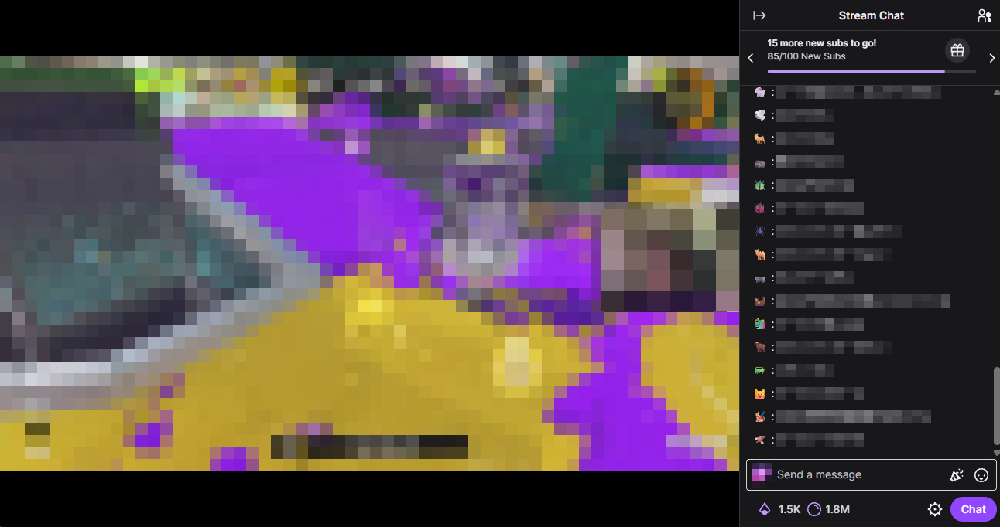
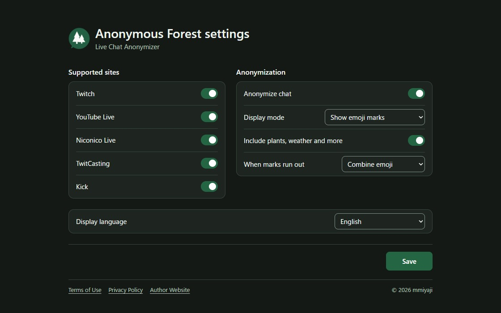

# Anonymous Forest – Live Chat Anonymizer

[日本語](README.md)

Anonymous Forest is a Chrome extension that replaces livestream chat usernames and badges with emoji marks or hides them entirely. It supports Twitch, YouTube Live, Niconico Live, TwitCasting, and Kick.

## Screenshots

The Twitch screenshot shows emoji marks on an actual livestream. The video and chat text are pixelated, while the emoji assigned by the extension remain visible.

## Install from source

1. Open `chrome://extensions/` in Chrome.
2. Turn on **Developer mode**.
3. Choose **Load unpacked** and select the folder containing `manifest.json`.
4. Reload any open livestream pages.

After updating the extension, click **Reload** on the Anonymous Forest card. If the popup says the tab is not connected, reload the livestream page as well.

## Use Anonymous Forest

Open Anonymous Forest from the Chrome toolbar, turn on **Anonymize chat**, and choose a display mode.

- **Show emoji marks.** Each chatter keeps the same emoji while you watch the same channel in the same tab. On Twitch (including 7TV), TwitCasting, and Kick, click the emoji to see the original profile.
- **Fully anonymous (no marks).** Hide usernames, badges, and emoji marks. The broadcaster’s username and badges remain visible.

On Twitch, pinned messages keep their text while the person who pinned them is anonymized. The chat leaderboard keeps its scores visible and hides usernames. Names typed into messages and information shown in the video remain visible.

## Advanced settings and supported sites

Open **Advanced settings** from the toolbar popup to choose which sites to anonymize, change the display mode or emoji options, and select English, Japanese, or **Match Chrome language**. Preferences are stored locally in Chrome.

- **Twitch** supports both the standard chat and 7TV.
- **YouTube Live** supports embedded and pop-out live chat. Archived chat replay is outside the supported scope.
- **Niconico Live** does not display usernames in its standard comment list, so those rows have no emoji marks. Anonymization hides the option to copy the user ID from the comment menu.

## Emoji marks

The extension uses fully qualified emoji from [Unicode Emoji 15.0](https://www.unicode.org/Public/emoji/15.0/emoji-test.txt). Their appearance and availability depend on your system’s emoji font.

| Category | Count |
| --- | ---: |
| Animals | 124 |
| Plants and flowers | 28 |
| Fruit and vegetables | 36 |
| Sky and weather | 47 |
| Total | 235 |

Each chatter starts with a one-emoji mark. By default, the extension uses animals first and combines emoji such as `🦊🌿` when the pool runs out. With up to two emoji per mark, the extension can distinguish 15,500 chatters using animals alone or 55,460 with the extra categories. You can also change the emoji pool, add numbers, or reuse marks. Reloading the page or switching channels resets the assignments.

## Terms and privacy

- [Terms of Use](https://mmiyaji.github.io/tokumeino-mori/terms.html?lang=en)
- [Privacy Policy](https://mmiyaji.github.io/tokumeino-mori/privacy.html?lang=en)
- [Author Website](https://ruhenheim.org/)

© 2026 mmiyaji
