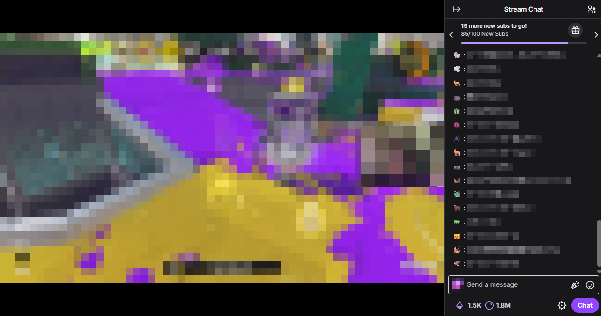
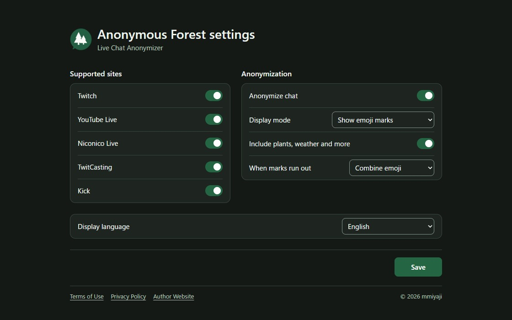

# 匿名の森｜配信チャット匿名化

[English](README.en.md)

配信チャットの投稿者名とバッジを絵文字マークに置き換えたり、非表示にしたりするChrome拡張です。Twitch、YouTube Live、ニコニコ生放送、ツイキャス、Kickに対応しています。

## スクリーンショット

英語UIのTwitch配信でマーク表示を使った画面です。配信映像とコメント本文にはモザイクをかけ、拡張が割り当てた絵文字は残しています。

## インストール

1. Chromeで `chrome://extensions/` を開きます。
2. 「デベロッパー モード」をオンにします。
3. 「パッケージ化されていない拡張機能を読み込む」を押し、`manifest.json` があるフォルダを選びます。
4. 開いている配信ページを再読み込みします。

更新後は「匿名の森」のカードにある再読み込みボタンを押します。ポップアップに「未接続」と表示された場合は、配信ページも再読み込みしてください。

## 使い方

ツールバーの「匿名の森」を開き、「匿名化をオンにする」と表示方法を選びます。

- **マークで見分ける**。同じタブで同じチャンネルを見ている間は、同じ投稿者に同じ絵文字を割り当てます。Twitch（7TVを含む）、ツイキャス、Kickでは、絵文字を押すと元のプロフィールを表示できます。
- **完全匿名（マークなし）**。投稿者名・バッジ・マークを隠します。配信者本人の名前とバッジは表示します。

Twitchの固定メッセージは本文を残し、固定した人も匿名表示にします。チャット上部のランキングはスコアを表示し、ユーザー名を隠します。Twitchのメンション・返信元の表示・サブスクなどの通知行も非表示になります。コメント本文に手入力された名前や、配信映像内に映っている情報はそのままです。

## 詳細設定と対応範囲

ポップアップの「詳細設定」から、サイトごとのオン・オフ、表示方法、絵文字の割り当て、表示言語を変更できます。表示言語は日本語・英語・Chromeの言語に合わせる、の3つです。設定はChromeにローカル保存します。

- **Twitch** は標準チャットと7TVに対応します。
- **YouTube Live** は視聴ページ内とポップアウトのライブチャットに対応します。アーカイブのチャットリプレイは対象外です。
- **ニコニコ生放送** の標準コメント一覧には投稿者名が出ないため、絵文字は付きません。匿名化中はコメントメニューのユーザーIDコピーを隠します。

## マークの種類

[Unicode Emoji 15.0](https://www.unicode.org/Public/emoji/15.0/emoji-test.txt) の完全修飾絵文字から選んでいます。絵柄や対応状況はOSの絵文字フォントによって異なります。

| カテゴリ | 種類数 |
| --- | ---: |
| 動物系 | 124 |
| 植物・花 | 28 |
| 果物・野菜 | 36 |
| 空・天気 | 47 |
| 合計 | 235 |

最初は1人につき絵文字1個を割り当てます。既定では動物から先に使い、候補を使い切ったら `🦊🌿` のように組み合わせます。2個までで動物のみなら15,500人、追加カテゴリも含めると55,460人まで区別できます。追加の絵文字を使う設定や、連番・再利用にも切り替えられます。ページの再読み込みやチャンネルの移動でマークを割り当て直します。

## 利用規約・プライバシー

- [利用規約](https://mmiyaji.github.io/tokumeino-mori/terms.html?lang=ja)
- 対応サイトのページURLとチャット上の投稿者名・識別子・バッジなどはブラウザ内で処理し、外部に送信しません。[プライバシーポリシー](https://mmiyaji.github.io/tokumeino-mori/privacy.html?lang=ja)
- [作者サイト](https://ruhenheim.org/)

© 2026 mmiyaji
